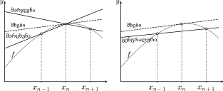

# 1. თავის სათაური

ლორემ იპსუმ დოლორ სიტ ამეტ, კონსექტიტურ ადიპისცინგ ელიტ, სედ დო ეიუსმოდ ტემგორ ინციდიდუნტუტ ლაბორე დეტ დოლორე მაგნა ალიკუა. უტ ენიმ ად $\min\left(v\right)$-ენიამ, კვის ნოსტრუდ ერთერციტაცტიონ ულლამკო ლაბორორის ნისი უკ ალიკვიპ ესტ ეა კომმოდო კონსეკუატ.

$$E = mc^2$$

# 2. თავის სათაური
ლორემ იპსუმ დოლორ სიტ ამეტ, კონსექტიტურ ადიპისცინგ ელიტ, სედ დო ეიუსმოდ ტემგორ ინციდიდუნტუტ ლაბორე დეტ დოლორე მაგნა ალიკუა. უტ ენიმ ად მინიმ ვენიამ, კვის ნოსტრუდ ერთერციტაცტიონ ულლამკო ლაბორორის ნისი უკ ალიკვიპ ესტ ეა კომმოდო კონსეკუატ.

# 3. თავის სათაური

{#fig:differentiation_schemes width=80%}

როგორც ნახაზზეა ([@fig:differentiation_schemes]) ნაჩვენები, ცენტრალური სხვაობით მიღებული წრფე გაცილებით უკეთ შეესაბამება $x_n$ წერტილში გამავალი მხების რეალურ დახრილობას, ვიდრე მარჯვენა ან მარცხენა აპროქსიმაციებით მიღებული წრფეები.

# 4. თავის სათაური

პუნქტების მაგალითი:

* წარმოებულის მარჯვენა აპროქსიმაცია $n$ ინდექსზე:
    $$y'_n \approx \frac{y_{n+1} - y_n}{\Delta x}~,$$

* წარმოებულის მარცხენა აპროქსიმაცია $n$ ინდექსზე:
    $$y'_n \approx \frac{y_n - y_{n-1}}{\Delta x}~,$$

* წარმოებულის ცენტრალური აპროქსიმაცია $n$ ინდექსზე:
    $$y'_n \approx \frac{y_{n+1} - y_{n-1}}{2\Delta x}~.$$
